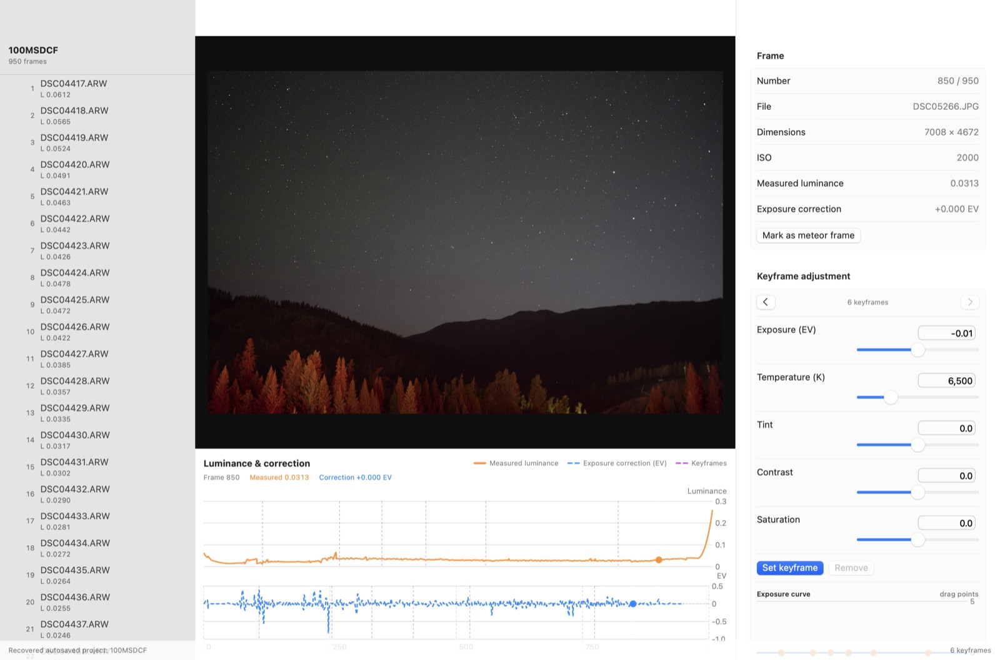
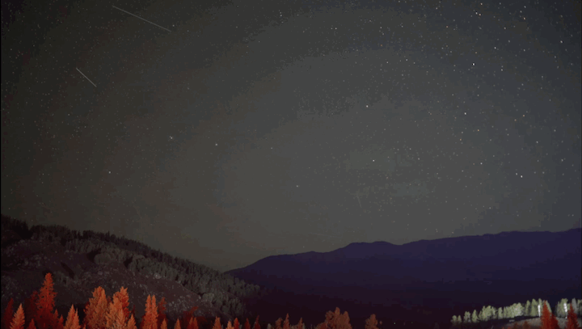
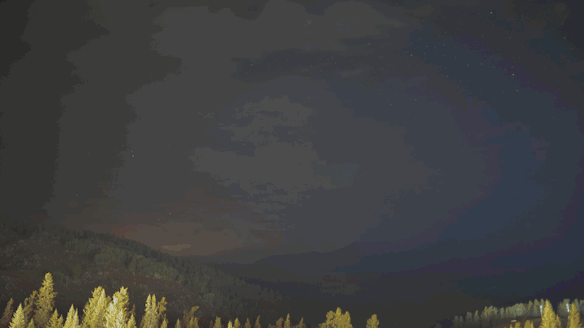

# TimeFlow Studio

<p align="center">
  <strong>原生 macOS 延时摄影、去闪烁与星轨制作工具。</strong>
</p>

<p align="center">
  简体中文 · <a href="README.md">English</a> ·
  <a href="../../releases">下载 Beta</a> ·
  <a href="FEATURE_CHECKLIST.md">功能清单</a> ·
  <a href="../../issues">反馈问题</a>
</p>



<p align="center"><sub>真实项目界面：图片浏览、亮度分析、修正曲线和关键帧控制。</sub></p>

TimeFlow Studio 是一款原生 macOS 图片序列处理工具，可制作延时摄影、星轨增长视频，以及从延时摄影自然过渡到星轨的混合视频。软件使用 SwiftUI、Core Image、ImageIO 和 AVFoundation 独立开发。

> **Beta 提醒：** 请保留原始照片和 XMP 边车文件的备份。重要项目使用前，先用短序列验证完整流程。

## 效果展示

<table>
  <tr>
    <th width="50%">星轨增长</th>
    <th width="50%">延时摄影 → 星轨</th>
  </tr>
  <tr>
    <td></td>
    <td></td>
  </tr>
  <tr>
    <td>逐帧累积星轨，可设置彗星尾、断点填充、流星保留和结尾停留。</td>
    <td>前半段保持普通延时摄影，后半段自然过渡为累积星轨，一次完成导出。</td>
  </tr>
</table>

<sub>以上动图为适配 GitHub 而压缩的预览；实际导出质量取决于 App 中选择的分辨率、编码器、码率和色彩空间。</sub>

## 主要功能

- 导入整个文件夹，或手动筛选 RAW/JPEG/PNG/TIFF/HEIC 照片。
- 分析序列亮度，并生成尽量保留日出、日落趋势的去闪烁修正。
- 设置曝光、色温、色调、对比度和饱和度关键帧并平滑插值。
- 读取、合并和备份 Adobe Camera Raw 兼容的 XMP 边车文件。
- 导出 H.264、HEVC、ProRes 422 LT 或 ProRes 422 视频。
- 生成静态星轨、星轨增长视频和延时到星轨的混合视频。
- 标记流星帧，在过滤飞机/卫星痕迹时保留流星，并设置停留时间。
- 长任务可安全取消；只有新文件完整生成后才会替换已有导出文件。

## 系统要求

- macOS 14 Sonoma 或更高版本
- 首个未签名 Beta 安装包仅面向 Apple Silicon Mac

## 下载

请前往 [GitHub Releases](../../releases) 下载最新版本。首个 Beta 使用临时签名，尚未经过 Apple 公证；首次打开时可能需要按住 Control 点击 App，再选择“打开”。下载后请使用发布页提供的 SHA-256 校验值核对文件。

## 从源码构建

安装 Xcode Command Line Tools 后运行：

```bash
swift build
swift test
swift run TimeFlow
```

生成本地 App：

```bash
./scripts/package_app.sh
```

项目没有第三方 Swift 包依赖，只链接 Apple 系统框架。

## 当前进度

已实现和待完成功能见 [FEATURE_CHECKLIST.md](FEATURE_CHECKLIST.md)，开发计划见 [ROADMAP.md](ROADMAP.md)。欢迎通过 GitHub Issues 提交问题和建议。

## 独立实现边界

TimeFlow Studio 根据独立需求和公开文件格式开发。所有贡献都必须遵守 [独立实现政策](docs/CLEAN_ROOM_POLICY.md)，不得提交其他产品的专有代码、图片、文案、凭据或绕过授权的材料。

## 开源许可

源代码采用 [Mozilla Public License 2.0](LICENSE)。MPL-2.0 以文件为边界要求修改后的相关文件继续开源，但不授予 TimeFlow Studio 名称和项目品牌的使用权，详情见 [TRADEMARKS.md](TRADEMARKS.md)。

其他资料：[贡献指南](CONTRIBUTING.md)、[安全政策](SECURITY.md)、[隐私说明](PRIVACY.md) 和 [支持说明](SUPPORT.md)。
